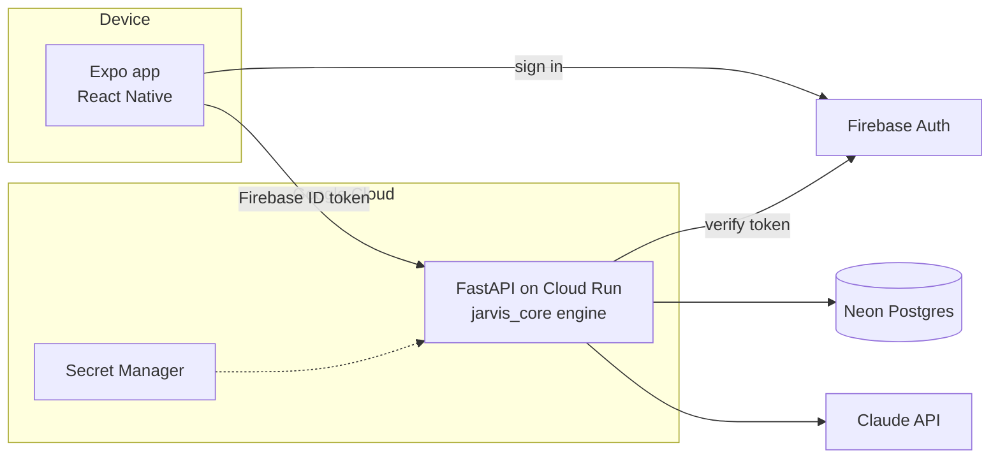

# Jarvis 2.0

Jarvis turns gym shorthand like `8x 160lb bench` into structured training and
body-weight data, then shows trends, one-rep-max forecasts and answers
questions about your training.

It's a React Native app (iOS and Android) backed by a Python API. It replaces
Jarvis 1.0, a Discord bot.

> Status: in development. Sections marked _TODO_ are filled in as each phase
> lands.

## Screenshots

| Log | Dashboard | Exercise | Ask Jarvis |
|---|---|---|---|
| _screenshot_ | _screenshot_ | _screenshot_ | _screenshot_ |

## What it does

- **Log in shorthand.** Type `5x 155lb 2x1x1xf bench`. A live preview splits it
  into sets, flags failed reps, and converts weights to pounds.
- **See progress.** Weekly sets and volume, a body-weight trend with a 7-day
  average and a projection.
- **Forecast lifts.** Estimated 1RM per exercise (Epley), rep targets, and the
  date you're projected to hit a target weight.
- **Ask Jarvis.** Ask about your training in plain English. Answers draw only on
  your own data.

## Architecture



_TODO: refine once Phase 2 is in._

## Repository layout

```
app/    Expo app (Expo Router, TypeScript)
api/    FastAPI service
  jarvis_core/   parsing and analysis engine (no web or DB code)
  jarvis_api/    HTTP layer, persistence, auth
docs/   setup and design notes
.github/workflows/  CI and deploy
```

## Tech stack

_TODO: one-line reason per choice._

| Layer | Choice | Why |
|---|---|---|
| App | Expo + Expo Router | |
| Data fetching | TanStack Query | |
| Charts | Victory Native | |
| Auth | Firebase Auth | |
| API | FastAPI + Pydantic v2 | |
| Persistence | SQLAlchemy 2 + Alembic, Postgres (Neon) | |
| AI | Claude via a swappable `LLMProvider` | |
| Hosting | Cloud Run | |
| CI/CD | GitHub Actions, Workload Identity Federation, EAS | |

## Design system

_TODO: tokens summary (color, spacing, type, components)._

## Run locally

Prerequisites: Node 20+, Python 3.12, Docker (optional, for Postgres). Cloud
setup steps are in [docs/SETUP.md](docs/SETUP.md).

### API

```bash
cd api
python -m venv .venv
source .venv/bin/activate        # Windows: .venv\Scripts\activate
pip install -e ".[dev]"
cp .env.example .env             # then fill in values
uvicorn jarvis_api.main:app --reload
```

### App

```bash
cd app
npm install
cp .env.example .env.local       # then fill in values
npx expo start
```

## Test

```bash
cd api && ruff check . && mypy && pytest
cd app && npx expo lint && npx tsc --noEmit && npm test
```

## Deployment

_TODO: Cloud Run via GitHub Actions + WIF; EAS Build/Submit/Update._

## License

_TODO_
