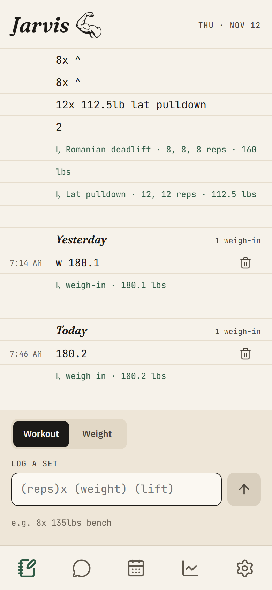
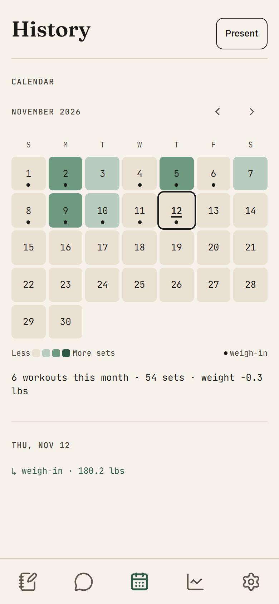
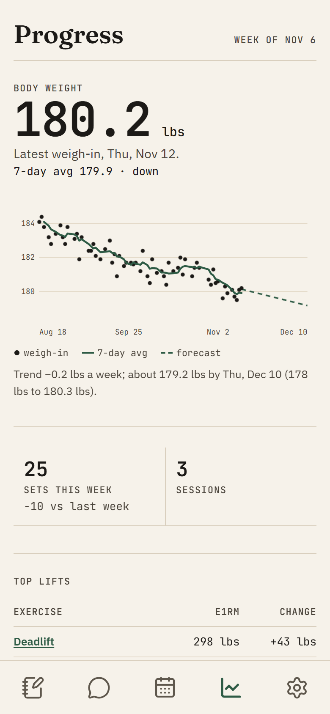
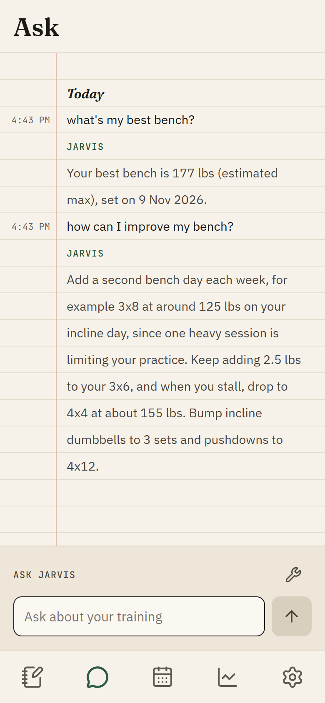
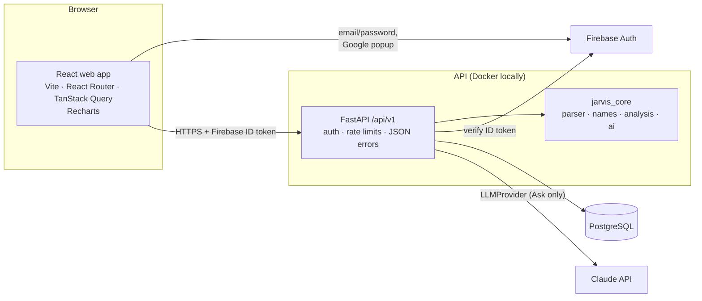

# Jarvis 2.0

Jarvis is a training notebook. Type your workout the way you'd jot it in a
notes app, `5x 155lbs 2x1x1xf bench`, and it's parsed into structured sets,
saved, and turned into trends, one-rep-max forecasts and answers about your
training.

It's a web app backed by a Python API, and the successor to Jarvis 1.0, a
Discord bot. The parsing engine is ported from the bot, and every slash command
is now a button.

## Screenshots

| Notebook | History | Progress | Ask |
|---|---|---|---|
|  |  |  |  |

The demo account.

## What it does

- **A notebook, not a form.** One ruled page, oldest to newest: the time sits
  in the margin, what you typed is written in mono, and a green "↳" note under
  it says what was logged ("↳ Bench · 3 reps · 155 lbs · ✗ last rep"); click
  it for the parsed sets. Days are headed "Monday, November 9" with a count of
  sets and weigh-ins. At the bottom, pick **Workout** or **Weight**, type,
  press Enter. Shift+Enter starts a new line, so a whole session can go in at
  once. The time you save is the entry's time, so there's no date field to
  fill in. The notebook is only for logging workouts and weight.
- **Deterministic logging.** Workout and Weight modes use the parser, never an
  LLM, so logging is instant and free. As you type, the same line reads the
  text back as the note it will get: `5x 155lbs 2x1x1xf bench` shows
  "↳ Bench · 5, 2, 1, 1, 1 reps · 155 lbs · ✗ last rep". kg is converted to lbs, `?` and ranges are estimates, `uw` is
  bodyweight, and `^` or a bare number repeats the set above.
- **Fix, don't retype.** The preview stays quiet while you type. Once saved,
  lines that didn't parse are marked "✗ Not logged" with the reason and
  one-click fixes ("Add unit: lbs", "Mark as estimate", "Set exercise
  name…", "Log as a weigh-in"). Saved entries can be edited, fixed or deleted
  (with undo); edits re-parse, like the bot re-parsed edited messages.
- **A weigh-in is saved as written.** The notebook is a notepad: every
  weigh-in counts in averages, trends, forecasts and monthly change, even one
  far from your 7-day average. A number typed without a unit is read as lbs or
  kg by its size, and the note spells out the conversion
  ("↳ weigh-in · 80 kg = 176.4 lbs"); edit the entry if it read wrong.
- **Every bot command is a button.** The Tools menu (wrench, on the Ask page): Stats (7/30/90 days), Lift,
  Estimate (maxes for 3–12 reps), Predict weight, Predict lift (the date
  you'll hit a target), Charts and Search, plus the
  Syntax cheat sheet. Exercise-name shortcuts are under Settings.
- **History and Progress.** A month heatmap shades each day by sets logged and
  dots weigh-in days; click a day for one table of its sets ("3 ✓ · 1 ✗") and
  its weigh-in. Progress leads with your latest weigh-in, then body
  weight with a 7-day average and a dashed forecast, this week's sets
  and sessions, and top lifts with e1RM charts and
  forecasts.
- **Settings that apply at once.** Your name, a new password (email
  accounts), lbs or kg (always stored in lbs), exercise names (shortcuts the
  parser applies), export every entry as one CSV, and delete the account and
  all its data. The empty bar is 45 lbs ("8x bar bench").
- **Ask, on its own page.** Only the Ask page calls Claude, and it sends only
  the data relevant to the question. Jarvis keeps answers concise and
  straight to the point. Every question and answer is saved, and the page
  shows them all, oldest first under day headings, with the question box at
  the bottom.

## Architecture



- **Raw text is the source of truth.** Each log stores what you typed; sets and
  weigh-ins are derived from it with a `parser_version`. Editing a log
  re-parses it and the rest of that day (names carry between logs). Bumping
  `PARSER_VERSION` and running `python -m jarvis_api.rebuild` re-derives every
  row.
- **Derived values are computed on read.** e1RM, volume, the calendar and
  projections are never stored, so they can't go stale.
- **Warnings come with machine-readable fixes.** The parser tags each warning
  with a code; the API turns it into concrete replacement lines the web app can
  apply with one click.
- **Every query is scoped to the caller.** All tables carry `user_id`, and tests
  check that one user can't read or change another's data.
- **`jarvis_core` is pure Python.** No web, database or third-party imports
  (enforced by a test), so the engine is tested in isolation.
- **Logging never calls the LLM.** A test saves, previews, edits and deletes
  logs against a mocked provider and asserts zero calls.

## Repository layout

```
web/                React web app (Vite, TypeScript strict)
  src/notebook/     the Notebook: feed, entry, composer, parse line, fixes
  src/tools/        the Tools menu (the bot's slash commands)
  src/pages/        Ask, History (calendar), Progress, lift detail, Settings, sign-in
  src/components/   UI built on the design tokens
  src/theme/        color tokens (also CSS variables in src/index.css)
  src/test/         Vitest + React Testing Library
api/                FastAPI service
  jarvis_core/      parsing and analysis engine
  jarvis_api/       HTTP layer, persistence, auth, LLM provider, fix suggestions
  migrations/       Alembic
  tests/            pytest (core + API)
docs/               SETUP.md (one-time setup), DEMO.md (demo checklist)
```

## Tech stack

| Layer | Choice | Why |
|---|---|---|
| Web | Vite, React 19, TypeScript strict | Fast dev server and builds; strict types end to end |
| Routing | React Router | Signed-in and signed-out route guards, deep links like `/progress/bench` |
| Data fetching | TanStack Query | Caching, the debounced parse-as-you-type, optimistic saves with rollback |
| Charts | Recharts (SVG) | Composed line, dot and bar charts with full control of colors and dashes |
| Auth | Firebase Auth (JS SDK) + Admin SDK | Email/password and the Google popup without running an auth server |
| API | FastAPI + Pydantic v2 | Typed request and response models and automatic validation |
| Persistence | SQLAlchemy 2 + Alembic, PostgreSQL | Typed ORM, versioned migrations; SQLite in tests |
| AI | Claude (`claude-opus-5-5`) behind an `LLMProvider` interface | Better coaching answers than a smaller model, over small contexts; provider and model are env vars |
| Quality | pytest, ruff, mypy strict; Vitest, ESLint, tsc | Every layer is linted, type-checked and tested in CI |

## Design system

All tokens (colors, type sizes, spacing, radius) live in one file,
[`web/src/theme/tokens.css`](web/src/theme/tokens.css), mirrored for charts in
[`tokens.ts`](web/src/theme/tokens.ts); a test keeps the two in sync.

A lifter's paper training logbook.

- **Color.** Warm paper (`#F6F2EA`), dark ink (`#1C1A17`) and one accent,
  forest green (`#2E5B45`): parse notes, the active tab, the save button and the
  average line. Rust (`#9A3B1E`) marks failed reps, always next to a ✗. A
  faint rule every 32px and a pink margin line make the Notebook a ruled page.
  No gradients. Every text color meets WCAG AA, checked by a unit test.
- **Type.** Fraunces for headings (italic for the wordmark and day headings),
  JetBrains Mono with tabular figures for anything logged or counted (entries,
  notes, times, stats), IBM Plex Sans for everything else.
- **Layout.** One column, about 480px wide, centered on a desktop, with the
  nav along the bottom (five icons: Notebook, Ask, History, Progress,
  Settings). Things sit directly on the
  page; rules, not cards, separate them. One 10px radius for controls and
  boxes, 6px for calendar cells; touch targets at least 44px.
- **Charts.** Ink dots for weigh-ins, the 7-day average as a solid green line,
  the forecast dashed, light gridlines, mono axis labels.
- **Motion.** Only two small ones: the parse note fades in, and the Workout /
  Weight highlight slides. Both stop when the system asks for reduced motion.
- **Quality floor.** Works from 360 to 430px with no sideways scroll, visible
  focus rings, every icon-only button labelled.

## Run locally

Full setup (Docker, Node, Firebase) is in [docs/SETUP.md](docs/SETUP.md); the
day-of-demo checklist is [docs/DEMO.md](docs/DEMO.md).

```bash
# API + Postgres
cp api/.env.example api/.env              # fill in FIREBASE_PROJECT_ID (+ ANTHROPIC_API_KEY for Ask)
# save the Firebase service account key as api/firebase-service-account.json
docker compose up -d --build              # Postgres + API on http://localhost:8000
docker compose exec api python -m jarvis_api.seed   # reset the demo account and fill it with history

# Web app
cd web
cp .env.example .env.local                # Firebase web config
npm install
npm run dev                               # http://localhost:5173
```

The web app calls `VITE_API_URL` (`http://localhost:8000` by default). The API
allows `http://localhost:5173` through CORS (`CORS_ORIGINS` in `api/.env`).

The seed makes up 12 weeks of history, unless the git-ignored folder
`api/demo_data` holds an exported `workouts.tsv` and `weighins.tsv`; then it
loads those instead (columns in [docs/SETUP.md](docs/SETUP.md) section 3).

## Test

```bash
cd api && ruff check . && ruff format --check . && mypy && pytest
cd web && npm run lint && npm run typecheck && npm test
```

CI runs both on every push ([.github/workflows/ci.yml](.github/workflows/ci.yml)).

Highlights:

- `api/tests/core`: every shorthand rule from Jarvis 1.0 (failure notation,
  estimates, multi-set chains, header lines, repeats), name matching,
  forecasts and projections.
- `api/tests/api`: auth on every route, user isolation, the demo login (fixed
  UID, email and password), rate limits, migrations and rebuild.
- `api/tests/api/test_notebook.py`: modes, fix suggestions, edit and delete
  (with same-day re-parsing), the calendar, the tools, CSV export, and that
  logging makes zero LLM calls.
- `web/src/test`: design-token contrast, the API client's timeout and error
  handling, the fix helpers, optimistic saving with rollback, the composer
  (Enter vs Shift+Enter), fixes, edit, delete with undo, the calendar, and the
  Ask page (earlier questions and answers, a streamed answer, retry).

## Security notes

- No secrets in the repo: `.env` files and the service account key are
  gitignored and excluded from the Docker image. `VITE_*` values are public
  client config only.
- New email/password accounts must open the verification link Firebase emails
  them before they can use the app; the API refuses unverified accounts too
  (`403 email_unverified`), so scripted sign-ups get nowhere. New passwords need
  12+ characters with an uppercase letter, a lowercase letter, a number and a
  symbol; the sign-up page ticks each one off as you type. Firebase's own
  password policy enforces the same rules
  (`python -m jarvis_api.password_policy --apply`), so they hold even for
  someone calling Firebase directly.
- The demo account is one fixed Firebase UID from server config that signs in
  with an ordinary email and password, set with `python -m jarvis_api.demo_login`.
  The password is never in the repo. In the app it behaves like any other
  account, password change included; only deleting it is refused by the API.
- Input limits (2,000-character logs, 500-character questions, 32 KB bodies),
  per-user rate limits on `/parse` and `/ask`, and a per-user daily token cap
  on Ask (the demo account has its own cap setting).
- Rate limits are in memory, which fits a single API instance. More instances
  would need a shared store.

## Roadmap

- Deployment: Cloud Run via GitHub Actions with Workload Identity Federation
  (steps in [docs/SETUP.md](docs/SETUP.md)), and static hosting for the web app
- Android and iOS builds (an Expo version existed before the web rewrite; see
  the git history)
- A nightly job that resets the demo account (run the seed by hand for now)
- End-to-end browser tests (Playwright)
- Alcohol and BAC tracking from Jarvis 1.0 (left out to keep the scope to
  workouts and weight)
