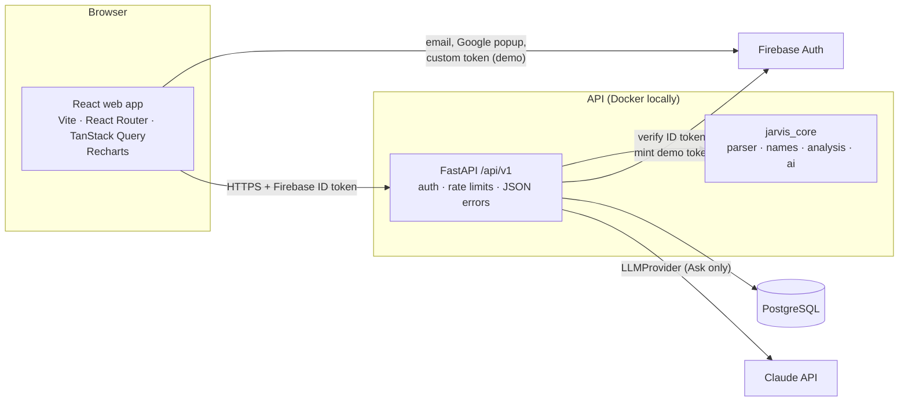

# Jarvis 2.0

Jarvis is a training notebook. Type your workout the way you'd jot it in a
notes app, `5x 155lb 2x1x1xf bench`, and it's parsed into structured sets,
saved, and turned into trends, one-rep-max forecasts and answers about your
training.

It's a web app backed by a Python API, and the successor to Jarvis 1.0, a
Discord bot. The parsing engine is ported from the bot, and every slash command
is now a button.

## Screenshots

| Notebook | Fixes | History | Progress | Ask mode |
|---|---|---|---|---|
| _screenshot_ | _screenshot_ | _screenshot_ | _screenshot_ | _screenshot_ |

## What it does

- **A notebook, not a form.** One feed, oldest to newest, with a plain text box
  at the bottom, like a chat. Pick a mode, **Workout**, **Weight** or **Ask**,
  type, press Enter. Shift+Enter starts a new line, so a whole session can go
  in at once. A small line above the box shows the date and time the entry will
  be logged at; that's its timestamp, so there's no date field to fill in.
- **Deterministic logging.** Workout and Weight modes use the parser, never an
  LLM, so logging is instant and free. As you type, the same line reads the
  text back: `5x 155lb 2x1x1xf bench` shows "5 sets · Bench" (the last one a
  failed rep). kg is converted to lb, `?` and ranges are estimates, `uw` is
  bodyweight, and `^` or a bare number repeats the set above.
- **Fix, don't retype.** Lines that don't parse are flagged with the reason and
  one-click fixes ("Add unit: lb", "Mark as estimate", "Set exercise
  name…", "Log as a weigh-in"). Saved entries can be edited, fixed or deleted
  (with undo); edits re-parse, like the bot re-parsed edited messages.
- **Every bot command is a button.** Tools: Today, Stats (7/30/90 days), Lift,
  Estimate (maxes for 3–12 reps), Predict weight, Predict lift (the date
  you'll hit a target), Volume, Charts, Search, Aliases, Export (CSV) and AI
  usage, plus the Syntax help cheat sheet.
- **History and Progress.** A month calendar marks workout days (filled) and
  weigh-in days (outlined); click a day for its entries. Progress shows body
  weight with a 7-day average and a dashed projection, this week's volume, and
  top lifts with e1RM charts and forecasts.
- **Ask, on purpose.** Only Ask mode calls Claude. It's marked in the accent
  color, sends only the data relevant to the question, and shows the tokens
  each answer used.

## Architecture



- **Raw text is the source of truth.** Each log stores what you typed; sets and
  weigh-ins are derived from it with a `parser_version`. Editing a log
  re-parses it and the rest of that day (names carry between logs). Bumping
  `PARSER_VERSION` and running `python -m jarvis_api.rebuild` re-derives every
  row.
- **Derived values are computed on read.** e1RM, volume, the calendar and
  projections are never stored, so they can't go stale.
- **Warnings come with machine-readable fixes.** The parser tags each warning
  with a code; the API turns it into concrete replacement lines the web app can
  apply with one click.
- **Every query is scoped to the caller.** All tables carry `user_id`, and tests
  check that one user can't read or change another's data.
- **`jarvis_core` is pure Python.** No web, database or third-party imports
  (enforced by a test), so the engine is tested in isolation.
- **Logging never calls the LLM.** A test saves, previews, edits and deletes
  logs against a mocked provider and asserts zero calls.

## Repository layout

```
web/                React web app (Vite, TypeScript strict)
  src/notebook/     the Notebook: feed, entry, composer, parse line, fixes
  src/tools/        the Tools menu (the bot's slash commands)
  src/pages/        History (calendar), Progress, lift detail, Settings, sign-in
  src/components/   UI built on the design tokens
  src/theme/        color tokens (also CSS variables in src/index.css)
  src/test/         Vitest + React Testing Library
api/                FastAPI service
  jarvis_core/      parsing and analysis engine
  jarvis_api/       HTTP layer, persistence, auth, LLM provider, fix suggestions
  migrations/       Alembic
  tests/            pytest (core + API)
docs/               SETUP.md (one-time setup), DEMO.md (demo checklist)
```

## Tech stack

| Layer | Choice | Why |
|---|---|---|
| Web | Vite, React 19, TypeScript strict | Fast dev server and builds; strict types end to end |
| Routing | React Router | Signed-in and signed-out route guards, deep links like `/progress/bench` |
| Data fetching | TanStack Query | Caching, the debounced parse-as-you-type, optimistic saves with rollback |
| Charts | Recharts (SVG) | Composed line, dot and bar charts with full control of colors and dashes |
| Auth | Firebase Auth (JS SDK) + Admin SDK | Email, Google popup and custom tokens without running an auth server |
| API | FastAPI + Pydantic v2 | Typed request and response models and automatic validation |
| Persistence | SQLAlchemy 2 + Alembic, PostgreSQL | Typed ORM, versioned migrations; SQLite in tests |
| AI | Claude (`claude-haiku-5-5`) behind an `LLMProvider` interface | Fast, cheap answers over small contexts; provider and model are env vars |
| Quality | pytest, ruff, mypy strict; Vitest, ESLint, tsc | Every layer is linted, type-checked and tested in CI |

## Design system

Colors live in [`web/src/theme/tokens.ts`](web/src/theme/tokens.ts) and as CSS
variables in [`web/src/index.css`](web/src/index.css) (a test keeps them in
sync); components use the variables, never raw values.

- **Color.** A warm-neutral palette with one accent (`#C2410C` light, `#F97316`
  dark), used only for the primary action, the current page, Ask mode and the
  main chart series. Light and dark follow the system setting. Every text and
  background pair meets WCAG AA, checked by a unit test.
- **Spacing.** A strict 8px grid (8, 16, 24, 32, 48, 64; 4 only for
  icon-to-label gaps). 48px between sections, 24px between items, touch
  targets of 44px or more. Content sits in a centered 640px column.
- **Type.** Manrope for UI text and JetBrains Mono for log text and numbers,
  with tabular figures. Six sizes (32/40 to 12/16) and two weights. Sentence
  case throughout.
- **Components.** Flat sections divided by whitespace and one hairline rule; no
  cards in cards, gradients, blur or glow. Lucide icons at stroke 1.75, and
  every icon-only button has an `aria-label`. Every view has a skeleton,
  a one-sentence empty state with one action, and an error state with retry.
  Everything works from the keyboard, with visible focus rings.
- **Charts.** Accent for the main series, `inkSecondary` for averages, dashed
  lines for forecasts, hairline gridlines.

## Run locally

Full setup (Docker, Node, Firebase) is in [docs/SETUP.md](docs/SETUP.md); the
day-of-demo checklist is [docs/DEMO.md](docs/DEMO.md).

```bash
# API + Postgres
cp api/.env.example api/.env              # fill in FIREBASE_PROJECT_ID (+ ANTHROPIC_API_KEY for Ask)
# save the Firebase service account key as api/firebase-service-account.json
docker compose up -d --build              # Postgres + API on http://localhost:8000
docker compose exec api python -m jarvis_api.seed   # demo account, 12 weeks of made-up data

# Web app
cd web
cp .env.example .env.local                # Firebase web config
npm install
npm run dev                               # http://localhost:5173
```

The web app calls `VITE_API_URL` (`http://localhost:8000` by default). The API
allows `http://localhost:5173` through CORS (`CORS_ORIGINS` in `api/.env`).

## Test

```bash
cd api && ruff check . && ruff format --check . && mypy && pytest
cd web && npm run lint && npm run typecheck && npm test
```

CI runs both on every push ([.github/workflows/ci.yml](.github/workflows/ci.yml)).

Highlights:

- `api/tests/core`: every shorthand rule from Jarvis 1.0 (failure notation,
  estimates, multi-set chains, header lines, repeats), name matching,
  forecasts and projections.
- `api/tests/api`: auth on every route, user isolation, the demo token (fixed
  UID, no claims, per-IP limits), rate limits, migrations and rebuild.
- `api/tests/api/test_notebook.py`: modes, fix suggestions, edit and delete
  (with same-day re-parsing), the calendar, the tools, CSV export, and that
  logging makes zero LLM calls.
- `web/src/test`: design-token contrast, the API client's timeout and error
  handling, the fix helpers, optimistic saving with rollback, and the
  composer (Enter vs Shift+Enter, Ask mode), fixes, edit, delete with undo, and
  the calendar.

## Security notes

- No secrets in the repo: `.env` files and the service account key are
  gitignored and excluded from the Docker image. `VITE_*` values are public
  client config only.
- "Try the demo" uses a Firebase custom token minted for one fixed UID from
  server config, with no extra claims, rate limited per IP (5/minute, 50/day).
  There is no demo password anywhere.
- Input limits (2,000-character logs, 500-character questions, 32 KB bodies),
  per-user rate limits on `/parse` and `/ask`, and a per-user daily token cap
  on Ask (lower for the demo account).
- Rate limits are in memory, which fits a single API instance. More instances
  would need a shared store.

## Roadmap

- Deployment: Cloud Run via GitHub Actions with Workload Identity Federation
  (steps in [docs/SETUP.md](docs/SETUP.md)), and static hosting for the web app
- Android and iOS builds (an Expo version existed before the web rewrite; see
  the git history)
- A nightly job that resets the demo account (run the seed by hand for now)
- Saving Ask conversations on the server (they're kept in the browser now)
- End-to-end browser tests (Playwright)
- Alcohol and BAC tracking from Jarvis 1.0 (left out to keep the scope to
  workouts and weight)

## License

MIT. See [LICENSE](LICENSE).
