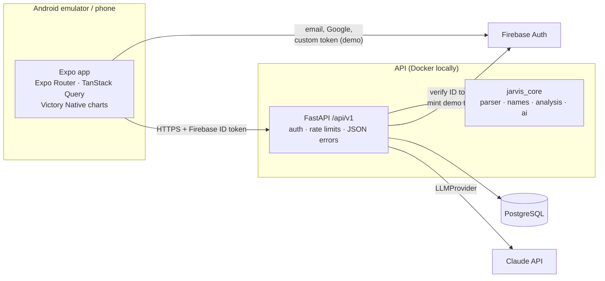

# Jarvis 2.0

Jarvis turns gym shorthand like `8x 160lb bench` into structured training and
body-weight data, then shows trends, one-rep-max forecasts and answers
questions about your training.

It's a React Native app for Android and iOS, backed by a Python API. It
replaces Jarvis 1.0, a Discord bot; the parsing engine is ported from it.

## Screenshots

| Sign in | Log | Dashboard | Exercise | Ask Jarvis |
|---|---|---|---|---|
| _screenshot_ | _screenshot_ | _screenshot_ | _screenshot_ | _screenshot_ |

## What it does

- **Log in shorthand.** Type `5x 155lb 2x1x1xf bench` and a live preview splits
  it into five sets, the last a failed rep. kg is converted to lb; `?` and
  ranges like `70/80kg` are marked as estimates; `uw` is bodyweight; `^` and a
  bare number repeat the set above.
- **See progress.** Today's work, sets and volume per week, and body weight with
  a 7-day average and a projection with a range.
- **Forecast lifts.** Estimated 1RM per exercise (Epley), rep targets for 1–12
  reps, and the date you're on pace to hit a target. Warm-up-only days are left
  out of the trend.
- **Ask Jarvis.** Ask about your training in plain English. Only the data
  relevant to the question is sent, and each answer shows the tokens it used.

## Architecture



- **Raw text is the source of truth.** Each log stores what you typed; sets and
  weigh-ins are derived from it with a `parser_version`. Bumping
  `PARSER_VERSION` and running `python -m jarvis_api.rebuild` re-derives every
  row.
- **Derived values are computed on read.** e1RM, volume and projections are
  never stored, so they can't go stale.
- **Every query is scoped to the caller.** All tables carry `user_id`, and a test
  checks that user A can't read or change user B's data.
- **`jarvis_core` is pure Python.** No web, database or third-party imports
  (also enforced by a test), so the engine is tested in isolation.

## Repository layout

```
app/                Expo app (TypeScript, Expo Router)
  src/app/          screens (file-based routes)
  src/components/   UI built on the design tokens
  src/theme/        color, spacing, radius and type tokens
  __tests__/        Jest + React Native Testing Library
api/                FastAPI service
  jarvis_core/      parsing and analysis engine
  jarvis_api/       HTTP layer, persistence, auth, LLM provider
  migrations/       Alembic
  tests/            pytest (core + API)
docs/               SETUP.md (one-time setup), DEMO.md (demo checklist)
```

## Tech stack

| Layer | Choice | Why |
|---|---|---|
| App | Expo SDK 58, React Native, TypeScript strict | One codebase for Android and iOS, with native builds generated from config |
| Navigation | Expo Router | File-based routes and protected route groups for signed-in vs signed-out |
| Data fetching | TanStack Query | Caching, retries and invalidation after a save, without hand-written state |
| Charts | Victory Native on Skia | Fast native charts with full control over colors, dashes and axes |
| Auth | Firebase Auth (JS SDK) + Admin SDK | Email and Google sign-in without running an auth server; the API verifies ID tokens |
| API | FastAPI + Pydantic v2 | Typed request and response models and automatic validation |
| Persistence | SQLAlchemy 2 + Alembic, PostgreSQL | Typed ORM, versioned migrations; SQLite in tests |
| AI | Claude (`claude-haiku-5-5`) behind an `LLMProvider` interface | Fast, cheap answers over small contexts; provider and model are env vars |
| Quality | pytest, ruff, mypy strict; Jest, ESLint, tsc | Every layer is linted, type-checked and tested in CI |

## Design system

Tokens live in [`app/src/theme`](app/src/theme) and every component uses them;
there are no hard-coded colors, sizes or font names in components.

- **Color.** A restrained warm-neutral palette with one accent (`#C2410C` light,
  `#F97316` dark), used only for the primary action, the selected tab and the
  main chart series. Light and dark follow the system setting. Every text and
  background pair meets WCAG AA, checked by a unit test.
- **Spacing.** A strict 8px grid (8, 16, 24, 32, 48, 64; 4 only for
  icon-to-label gaps). 24pt screen padding, 48pt between sections, 24pt
  between items, 48×48 minimum touch targets.
- **Type.** Manrope for UI text and JetBrains Mono for the log input, parsed
  rows and numbers, with tabular figures. Six sizes (32 to 12) and two weights.
  Text scales with the system setting up to 1.3×. Sentence case throughout.
- **Components.** Flat sections divided by whitespace and one hairline rule;
  no cards in cards, gradients, blur or glow. One primary, one secondary and
  one text button. Lucide icons at stroke 1.75. Every screen has a skeleton
  loading state, a one-sentence empty state with one action, and an error
  state with a retry.
- **Charts.** Accent for the main series, `inkSecondary` for averages, dashed
  lines for forecasts, hairline gridlines.

## Run locally

The full walkthrough for a Windows laptop with the Android emulator, including
Firebase and Google sign-in, is in [docs/SETUP.md](docs/SETUP.md). The
day-of-demo checklist is [docs/DEMO.md](docs/DEMO.md).

### API (Docker)

```bash
cp api/.env.example api/.env              # fill in FIREBASE_PROJECT_ID
# save the Firebase service account key as api/firebase-service-account.json
docker compose up -d --build              # Postgres + API on http://localhost:8000
docker compose exec api python -m jarvis_api.seed   # demo account, 12 weeks of made-up data
```

Or without Docker:

```bash
cd api
python -m venv .venv && source .venv/bin/activate   # Windows: .venv\Scripts\activate
pip install -e ".[dev]"
docker compose up -d db                   # or point DATABASE_URL at any Postgres
alembic upgrade head
uvicorn jarvis_api.main:app --reload --host 0.0.0.0 --port 8000
```

### App (Android emulator)

```bash
cd app
npm install
cp .env.example .env.local                # Firebase web config
npx expo run:android                      # builds a debug build and installs it
```

The app calls `EXPO_PUBLIC_API_URL`, `http://10.0.2.2:8000` by default (the
emulator's alias for the host machine). Debug builds allow cleartext HTTP for
local development; release builds don't.

## Test

```bash
cd api && ruff check . && ruff format --check . && mypy && pytest
cd app && npx expo lint && npx tsc --noEmit && npx jest
```

CI runs both on every push ([.github/workflows/ci.yml](.github/workflows/ci.yml)).

Highlights:

- `api/tests/core`: every shorthand rule from Jarvis 1.0 (failure notation,
  estimates, multi-set chains, header lines, repeats), name canonicalization,
  forecasts and projections.
- `api/tests/api`: auth on every route, user isolation, the demo token (fixed
  UID, no claims, per-IP limits), rate limits, migrations, rebuild, and a test
  that logging `5x 155lb 2x1x1xf bench` moves the bench forecast.
- `api/tests/api/test_ask.py`: Ask Jarvis with a mocked provider, covering daily caps,
  timeouts and refusals.
- `app/__tests__`: design-token contrast, the API client's timeout and error
  handling, the parsed-set table, sign-in, the Log preview and Ask Jarvis
  error states.

## Security notes

- No secrets in the repo: `.env` files and the service account key are
  gitignored and excluded from the Docker image. `EXPO_PUBLIC_*` values are
  public client config only.
- "Try the demo" uses a Firebase custom token minted for one fixed UID from
  server config, with no extra claims, rate limited per IP (5/minute, 50/day).
  There is no demo password anywhere.
- Input limits (2,000-character logs, 500-character questions, 32 KB bodies),
  per-user rate limits on `/parse` and `/ask`, and a per-user daily token cap
  on Ask Jarvis (lower for the demo account).
- Rate limits are in memory, which fits a single API instance. Running more
  instances would need a shared store.

## Roadmap

Cut from the MVP, in rough priority order:

- Editing and deleting logs from History (History is read-only for now)
- Exercise aliases screen (the `/aliases` API exists; there's no screen yet)
- CSV export with the share sheet
- A Maestro end-to-end flow
- A nightly job that resets the demo account (run the seed by hand for now)
- Deployment: Cloud Run via GitHub Actions with Workload Identity Federation
  (steps already in [docs/SETUP.md](docs/SETUP.md) sections 6–11)
- EAS Build and Submit for TestFlight and Google Play internal testing, and
  EAS Update for JS-only fixes
- iOS testing, Sign in with Apple, push notifications, a web version

## License

MIT. See [LICENSE](LICENSE).
